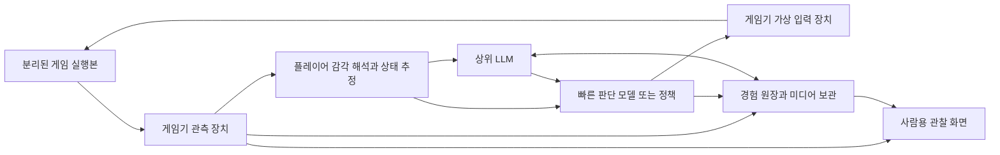

# AI 전용 게임기 설계 초안

작성일: 2026-10-17 KST. 상태: 설계만 작성, 구현과 실험은 시작하지 않음.

게임기는 관측·입력·기억 장치를 제공하고 모든 게임 판단은 교체 가능한 AI 플레이어가 담당한다. 정상적으로 표시되는 UI는 OCR 없이 전달하고, 소리는 출력 이벤트로 전달하며, 영상 인식은 필요한 상황에 선택적으로 사용한다. 게임기 자체에는 유료 모델을 필수 구성 요소로 넣지 않는다.

이 문서는 향후 구조의 기준이다. 기존 [v0.1 구조](architecture.md)는 초기 구현 기록으로 보존한다. 실제 현재 기능은 [입력 안내](live-control.md)와 [인계 기록](handoff.md), 모델 비교와 예산은 [로컬 실험 계획](local-decision-model-experiment.md)을 참고한다.

게임 파일을 추가 점검한 결과와 증거는 [로보토미 파일 적합성 점검](lobotomy-file-compatibility-audit.md)에 있다. 아래 일반 계약을 구현할 때는 이 점검에서 확인한 전용 표시 경로를 우선 사용한다.

## 로보토미 파일에 맞춘 구현 우선순위

게임은 Unity 2017.4.7f1의 관리 코드와 직렬화된 씬을 사용한다. 첫 어댑터는 `GameStatusUI.Window.energyContorller`, `AgentInfoWindow.currentWindow`, `CreatureInfoWindow.CurrentWindow`를 캐시해 완료된 표시 필드를 읽는 방식으로 좁힌다. 전역 Text 검색 빈도를 높이거나 범용 가림 해석기를 먼저 만들지 않는다.

직원 HUD의 `BlackHide`와 환상체 정보의 `OpenArea`는 값이 들어 있는 UI 앞을 덮는 실제 구현이다. 이 덮개, 활성 branch, 스크롤 마스크, 애니메이션 완료와 카메라 경로를 함께 검사한다. `Notice`, `UIController`, Graphic dirty 알림은 변경 감지에 활용할 수 있지만 최종 가시성의 증거는 아니다. 처음에는 캐시된 표시 필드를 제한된 주기로 읽고, 병목이 확인되면 hook을 추가한다.

오디오는 여러 매니저 밖에서도 AudioSource를 직접 호출한다. 공통 출력 호출 wrapper와 재생 상태 registry를 후보로 두고 소리 매니저 한 곳에만 의존하지 않는다. 영상은 다중 카메라·Overlay까지 합성된 화면을 대상으로, 설치 버전이 지원하는 캡처의 비용을 먼저 측정한다. 조사한 관리 DLL에 없는 AsyncGPUReadback을 기본 전제로 사용하지 않는다. 아래 주기와 지연 목표는 여전히 실측 전이다.

## 목표와 범위

목표는 게임을 대신 조작하는 도구와, 경험을 쌓고 다른 모델에 전달하는 플레이어를 분리하는 것이다. 게임기 교체 없이 여러 플레이어를 연결하고, 플레이어의 관측·선택·실패·수정 과정을 사람이 볼 수 있어야 한다.

- 원본 게임 설치와 기존 세이브를 보존한다. 실행은 기존의 별도 복사본과 별도 저장 경로를 사용한다.
- 사람의 OS 마우스와 게임 내부 포인터를 분리한다. 관찰 페이지는 게임 입력을 보내지 않는다.
- 플레이어가 공개된 표시 정보를 쉽게 받는 것은 허용한다. 가려진 정보, 아직 공개되지 않은 규칙, 내부 수치의 추가 정밀도는 제공하지 않는다.
- 오디오 이벤트와 정확한 표시 문자열은 인간의 감각과 완전히 같지 않은 보조 인터페이스다. 이 차이를 실험 조건에 명시한다.
- 모델의 사전 학습 지식을 지웠다거나, 기록 이전이 모델 가중치 학습 또는 인간의 주관적 경험을 재현한다고 주장하지 않는다.
- 이 문서를 근거로 모델 설치, 세이브 변경, 플레이 재개, 유료 호출을 자동 시작하지 않는다.

## 게임기와 플레이어의 경계

| 기능 | 게임기 | 플레이어 |
| --- | --- | --- |
| 시각 | 최종 영상 확보, 검증된 표시 정보 추출, 표시 불확실성 전달 | 객체 인식, 추적, 의미 해석, 위험 판단 |
| 청각 | 실제 재생에 대응하는 익명 사운드 이벤트와 선택적 원음 | 소리의 의미 학습, 경고와 상황의 연결 |
| 입력 | 포인터·키·버튼 상태 적용, 만료·취소·해제, 적용 확인 | 행동 후보 생성, 대상·시점·지속 시간 선택 |
| 빠른 대응 | 낮은 지연으로 관측과 명령 전달 | 회피·직원 구출·게임 일시정지 판단 |
| 기억 | 사건 저장, 검색, 원본 재생, 출처·상속 관계 보존 | 기억 선택, 가설·교훈·성향 작성, 경험 활용 |
| 사람과 대화 | 메시지와 기록의 전달 및 관찰 화면 | 설명·답변·방침 변경 |
| 장애 대응 | 연결 끊김 시 입력 해제, 큐 제한, 상태 보고 | 대기·추가 관찰·상위 모델 요청 등 게임 대응 |

게임기가 위험을 판정해 자동으로 회피하거나 게임 시간을 멈추지 않는다. 장치의 입력 중지는 게임의 일시정지와 다르다. 게임 자체에서 정지를 제한하면 이를 우회하지 않는다.

빠른 모델, 행동 트리, OCR, 영상 추적기, 기억 요약기는 모두 플레이어 쪽의 선택 가능한 구성 요소다. 표시 영역을 클리핑하거나 이벤트 중복을 제거하는 기계적 처리는 게임기에 둔다. 게임에 관한 의미 판단과 정책을 추출기에 숨겨 넣지 않는다.

MCP는 관측 요약·단발 입력·기억 조회·대화의 연결점으로 유지한다. 지속 영상과 빠른 입력은 로컬 IPC를 별도로 사용한다. 매 프레임을 MCP 왕복이나 상위 LLM 호출로 처리하지 않는다. 구체적인 IPC 구현은 이후 측정으로 선택한다.

## 최종 표시 정보 추출

### 허용되는 관측

| 화면에서 공개된 형태 | 전달 내용 | 전달하지 않는 내용 |
| --- | --- | --- |
| 숫자와 문자열 | 실제 표시 문자열, 위치, 해당 프레임 | 반올림 전 내부 값, 숨겨진 설명 |
| 체력 등 막대 | 화면 픽셀 길이에 맞춘 구간 또는 비율 | 표시되지 않은 정확한 최대값·현재값 |
| 버튼·아이콘 | 표시 라벨 또는 이미지 참조, 화면 영역 | 내부 기능명으로 추정한 의미·성공 여부 |
| 보이지 않는 항목 | 관측 취소 또는 현재 이용 불가 | 마지막 값을 최신 값으로 재전송 |
| 일부 가려지거나 왜곡된 항목 | 검증된 부분 또는 이미지 참조 | 가려지기 전 원문 복원 |

`interactable` 같은 내부 속성도 시각적 활성 표시와 동등하다고 검증한 경우에만 전달한다. 누를 수 있는지 내부 코드로만 알 수 있다면 플레이어에게 성공 가능성을 미리 알려주지 않는다.

### 추출 순서

1. **후보 수집:** 렌더링용 텍스트·UI 도형에서 문자열과 화면 영역을 수집한다. 아직 플레이어에게 공개하지 않는다. 게임 모델의 HP, AI 상태, 애니메이터 상태명 등은 이 후보에 포함하지 않는다.
2. **표시 갱신 확인:** UI 레이아웃과 표시 데이터 갱신 이후에 수집한다. 렌더링 직전 콜백을 사용했다는 사실만으로 최종 가시성을 증명하지 않는다.
3. **가시성 판정:** 화면 경계, 알파, 부모 마스크, 클리핑, 앞에 놓인 레이어, 적용되는 카메라·후처리 경로를 검사한다. 구현 첫 단계는 검증 가능한 UI 종류의 허용 목록으로 제한한다.
4. **최종 프레임 연결:** 표시 항목에 해당 렌더 프레임 ID와 영역을 붙이고, 검증용 최종 이미지와 연결한다. 화면 전체 왜곡과 UI 오버레이의 영향을 영역별로 확인한다.
5. **공개와 철회:** 검증된 항목만 전송한다. 가림·불확실성이 발생하면 현재 값을 철회한다. 이전 관측은 과거 기억으로만 남긴다.

관측 상태는 `verified_visible`, `partial`, `unavailable`, `unverified`로 구분한다. `verified_visible`도 사람이 동일하게 읽을 수 있다는 철학적 보증이 아니라, 정해진 표시 검증을 통과했다는 뜻이다. 부분 가림은 실제 보이는 글자 구간까지 검증할 수 없으면 문자열 전체를 공개하지 않는다.

일반적인 GPU 후처리 결과를 원본 문자열에서 완벽하게 역산할 수 있다고 가정하지 않는다. 영향 범위가 불명확하면 해당 경로 전체를 `unverified`로 낮추고 이미지를 제공한다. 화면 변화 비교, 제한된 UI의 렌더 기여도 검사 등은 후보 기법이며, 마스크·ID 버퍼만으로 최종 가독성을 보장하지 않는다.

후처리의 내부 보스 이름이나 효과를 발생시킨 이유는 공개하지 않는다. 관측 불확실성 알림 자체가 숨겨진 기믹을 알려주는 부채널이 되지 않도록 일반적인 가시성 상태만 사용한다.

OCR는 필수가 아니다. 직접 추출이 어려운 장면에 대해 플레이어가 OCR·작은 비전 모델·상위 멀티모달 모델 중 선택한다. 원본 코드·게임 데이터·개발 진단 스트림은 플레이어 인터페이스와 분리한다. 현재 개발 채팅의 파일 접근 권한은 이러한 분리를 강제하는 보안 장벽이 아니므로, 향후 실험은 제한된 도구만 노출하는 별도 플레이어 호스트가 필요하다.

### 가상 커서

가상 입력 좌표 외에 게임이 실제 표시하는 커서 이미지·핫스폿·크기·표시 여부를 재현해야 한다. 커서의 내부 타입명을 의미 정보로 보내지 않는다. 최종 캡처에 포함되지 않는 커서는 검증된 출력 정보를 이용해 같은 위치에 합성한다. 현재의 고정 십자 표시만으로 원래 커서 표현을 대신했다고 보지 않는다.

디버그 표시와 판단 해설은 사람용 뷰어에서 덧그린다. 플레이어 영상 위에 관찰 도구 배너가 게임 HUD를 가리지 않도록 한다.

## 오디오 이벤트

첫 버전의 청각 계약은 `audio_event_proxy`다. 파형을 인간과 같은 방식으로 듣는다는 뜻이 아니라 실제 출력에 대응하는 사건을 전달한다는 뜻이다.

| 필드 | 의미 |
| --- | --- |
| `sound_instance_id` | 이번 재생의 식별자 |
| `sound_token` | 동일 소리를 다시 알아보기 위한 의미 없는 식별자 |
| `event_type` | 시작, 종료, 반복 상태 변경, 음량 변화 |
| `t_start`, `t_observed` | 시작과 감지 시각, 추정치이면 오차 표시 |
| `gain_bucket`, `pan_bucket` | 거친 음량·좌우 방향, 확인 불가이면 null |
| `audibility_basis` | 출력 신호 검증 또는 재생 상태 기반 근사 |
| `media_ref` | 보관된 짧은 원음이 있을 때 참조 |

재생 요청이 취소되거나 출력되지 않았다면 실제 소리 사건으로 확정하지 않는다. 음소거·리스너 볼륨·알려진 거리 감쇠를 반영한다. 믹싱과 소리 겹침 때문에 실제 청취 가능성을 보장할 수 없으면 근사임을 남긴다. 사람이 구분하기 어려운 소리를 이벤트로 분리해 받는 이점도 실험 조건에 명시한다.

파일 경로, 의미 있는 클립명, 발생시킨 숨은 객체 ID, 월드 좌표는 공개하지 않는다. 같은 오디오 내용을 재사용한 자산은 가능한 한 같은 토큰으로 취급해 내부 자산 구분이 새 정보를 주지 않게 한다. 소리의 의미는 플레이어가 관측 결과와 연결해 학습한다. 음성 대사 원문도 내부 스크립트에서 자동 제공하지 않는다. 화면 자막 또는 플레이어의 선택적 음성 인식을 사용한다.

## 전달 주기와 시간 계약

아래 수치는 **첫 구현의 측정 시작점과 목표**다. 현재 달성한 성능이나 게임 전체에서 충분한 반응 시간이라는 뜻은 아니다. 게임 렌더링 속도보다 빠른 새 관측을 만들어 내지 않는다.

| 채널 | 초기 설정 | 전달 및 보존 |
| --- | --- | --- |
| 표시 문구·수치 | 후보 검사 최대 20Hz, 변경분 묶음 최대 100ms | 가림에 따른 철회도 같은 주기로 전달, 전체 동기화 1초마다 |
| 사운드 | 가능한 출력 이벤트 감지, 묶음 최대 50ms | 시작·종료 순서 유지, 진행 중 소리 요약 1초마다 |
| 영상 | 로컬 15fps로 시작, 30fps 비교 | 최근 30초 순환 버퍼, 프레임 누락·실제 fps 기록 |
| 관심 영역 영상 | 플레이어 요청 시 15 또는 30fps 구독 | 원본 프레임 좌표와 연결, 숨은 영역 복원 없음 |
| 가벼운 화면 변화 감지 | 플레이어 쪽에서 5~10Hz 시작 | 색·움직임 변화만으로 위험을 확정하지 않음 |
| 큰 비전 모델 | 기본 상시 호출 없음 | 새 장면·불확실성·플레이어 요청 시, 감시용 전체 확인은 예를 들어 30초 간격부터 비교 |
| 빠른 판단 모델 | 새 중요 관측 또는 플레이어 타이머 | 동시 추론 1개, 밀린 과거 판단을 순서대로 실행하지 않음 |
| 상위 LLM | 목표 변경·낯선 상황·회고·대화 시 | 초당 정기 호출을 요구하지 않음 |
| 사람용 뷰어 | 10~15fps 시작, 지원 시 30fps | 관찰 지연 표시, 게임 입력 기능 없음 |

주기를 낮추는 것과 정보를 누락하는 것을 구별한다. 수치는 최신 변경분으로 병합할 수 있지만 소리 시작·종료, 가시성 철회, 입력 적용 사건은 순서를 유지한다. 누락이 생기면 `gap`을 전달하고 전체 상태를 다시 받는다. 오래된 프레임은 최신 관측 채널에서 버릴 수 있어도 보관 누락 횟수는 남긴다.

모든 채널에는 `session_id`, `stream_id`, `sequence`, `t_source`, `t_published`, `frame_id` 또는 구간, `quality`, `schema_version`을 둔다. 순서·지연 측정은 공통 단조 시계를 사용하고, UTC는 기록 연결에 사용한다. Windows 게임과 WSL 모델 사이의 서로 다른 시계를 직접 빼지 않는다. 모델 왕복은 Windows 중계기의 같은 시계로 측정하고 내부 구간은 각 프로세스에서 측정한다.

플레이어가 만드는 상태 묶음은 항목별 관측 시각을 보존한다. 새 수치와 오래된 이미지를 합쳤다면 이미지가 오래되었다는 사실이 남아야 한다. 화면이 가려져도 이미 알고 있던 사실은 기억할 수 있지만 현재 관측으로 승격하지 않는다.

## 입력과 실행 결과

가상 마우스는 게임 좌표계에 존재하며 OS 포인터와 전경 창을 이동시키지 않는다. 키 조합, 마우스 버튼 유지, 포인터 이동과 키의 동시 사용을 표현할 수 있는 입력 상태를 목표로 한다. 보이지 않는 객체 ID를 직접 지정하는 작업 API는 제공하지 않는다.

입력 계약은 다음과 같다.

| 필드 | 내용 |
| --- | --- |
| `command_id`, `decision_id` | 중복 실행 방지와 판단 연결 |
| `owner_id`, `owner_epoch` | 현재 입력 권한을 가진 플레이어와 권한 세대 |
| `based_on` | 관측 ID, 프레임 ID, 장면·해상도·프로세스 세대 |
| `pointer`, `keys_down`, `buttons_down`, `wheel` | 화면 픽셀 기준 위치와 원하는 입력 상태 |
| `not_after`, `lease_ms`, `cancel_of` | 적용 기한, 유지 임대 시간, 취소 대상 |
| `receipt` | 거부·접수·적용·해제·불명확 상태와 적용 프레임·시각 |

연속 입력의 초기 임대 시간은 250ms, 갱신 간격은 100ms를 검토한다. 통신·프레임 지연을 측정해 조정한다. 길게 누르기는 플레이어 실행 루프가 임대를 갱신한다. 독립 단발 입력은 기존 최대 3초 범위를 유지할 수 있지만 취소 가능해야 한다. 연결 종료·만료·장면 세대 변경 시 장치가 입력을 해제한다.

빠른 모델과 상위 LLM이 동시에 입력하지 않는다. 상위 LLM은 정책을 제안하고, 플레이어 조정기가 정책 전환과 입력 소유권을 관리한다. 기한이 지난 판단은 적용하지 않는다. 응답이 사라진 명령은 조회로 조정하며 자동 재전송하지 않는다.

`applied`는 게임 입력에 반영되었다는 뜻이다. 작업 시작·선택 성공·전투 결과는 별도의 후속 관측으로 확인한다. 문구가 같은 버튼이라도 움직였으면 이전 좌표가 유효하다고 가정하지 않는다.

## 경험 기록과 회상

저장 장치는 원본 사건을 덧붙여 보존한다. 플레이어가 작성한 해석은 관측과 다른 종류로 저장하며, 수정할 때는 정정 사건을 추가한다.

| 기록 종류 | 최소 내용 |
| --- | --- |
| `observation` | 실제 제공한 표시·소리·영상 참조, 시간, 가시성, 누락 |
| `belief` | 플레이어가 믿는 상태, 근거, 마지막 관측, 추정 여부 |
| `decision` | 목표, 후보와 생성 출처, 선택, 점수, 정책·모델 버전, 참조 기억 |
| `action_receipt` | 요청과 실제 적용·해제, 취소·실패·불명확 상태 |
| `outcome` | 후속 관측 연결, 예상과의 차이, 인과관계 확실성 |
| `reflection` | 새 가설·교훈·불확실성, 정정 대상 |
| `human_intervention` | 질문·방침 변경·실제 조작·운영자 중지 구분 |
| `memory_access` | 검색어·조건, 반환한 경험 ID, 실제 사용한 경험 ID |
| `explanation` | 당시 짧은 자기 보고 또는 나중의 해설이라는 구분 |

공통 필드는 사건 ID·세션 ID·순번·시각·스키마 버전·출처·참조 사건 ID다. 경험 묶음에는 게임기 버전, 게임/관측 프로필, 모델과 정책 버전, 실험 조건을 기록한다. 내부 진단 정보는 플레이어에게 전달되는 묶음에서 제외한다.

예를 들어 소리 `sound_017` 직후 화면 변화가 있었고 플레이어가 입력을 취소했다면, 소리 사건 → 당시 가설 → 취소 결정 → 해제 영수증 → 후속 화면 → 가설 수정이 연결된다. 장치가 그 소리에 먼저 위험이라는 이름을 붙이지 않는다.

빠른 모델이 이유를 생성하지 않은 경우 후보 점수와 선택을 기록한다. 나중에 LLM이 붙인 설명을 당시 이유로 바꾸지 않는다. 비공개 사고 과정을 수집하거나 확률 분포만으로 실제 내부 이유를 알 수 있다고 주장하지 않는다.

### 저장 위치와 용량

- 원장과 실제 관측: `.robotomy/experience/` 아래 SQLite 및 미디어 인덱스. 현재 live 파일 기록에서 옮기는 작업은 별도 구현이다.
- 영상·선택적 음성: `media/` 또는 지정한 D 드라이브 보관소. 압축된 최근 30초를 순환 보관하고, 플레이어가 지정한 사건은 앞 10초·뒤 10초 구간을 보존한다.
- Obsidian: `vault/Experiences/`에 검토한 경험, `vault/Player/`에 출처가 연결된 성향과 목표. 자동 생성 읽기 화면과 사람의 주석은 분리한다.
- Git: 설계·스키마·검토한 텍스트와 필요한 작은 근거 목록만 관리한다. 모델 가중치·게임 자산·세이브·전체 미디어는 제외한다.

초기 미디어 상한은 20GiB, 디스크 잔여 50GiB에서 추가 영상 고정 저장을 중단하는 안으로 시작한다. 보존하기로 고정한 근거를 자동 삭제하지 않는다. 공간 부족·미디어 누락을 사건으로 기록하고 텍스트 기록은 가능한 한 계속한다. 한 프레임씩 PNG로 영구 저장하는 방식은 지속 영상 경로에 사용하지 않는다.

### 검색과 이전

1. 초기 검색은 SQLite 전문 검색과 소리 토큰·사건 종류·시점·경험 태그 필터를 사용한다. 임베딩 모델은 필수가 아니다. 한국어 검색 품질은 별도로 평가한다.
2. 검색 결과는 요약과 함께 원래 관측·판단·결과 링크를 제공한다. 플레이어가 접근할 수 없는 개발 자료는 검색 색인에 넣지 않는다.
3. 내보내기는 스키마 버전, 원래 사건 ID, 작성 모델, 경험 종류, 상속 경로, 내용 해시와 선택적 미디어 목록을 포함한다.
4. 새 모델은 경험을 `direct`와 `inherited`로 구분한다. 요약의 오류는 원문 보존 상태에서 정정한다. 가져온 문장 자체를 실행 지시로 취급하지 않는다.
5. 동일 기록의 왕복 성공과 실제 행동 개선은 별도로 평가한다. 기억 없음·요약만·사건 연결 기억을 같은 조건으로 비교한다.

현재 구현의 경험 번들·검색은 합성 환경 중심이며, 실제 게임 기록 전체가 이미 검색·이전되는 것은 아니다. [현재 저장 구조](experience-storage.md)의 이 제한은 live 통합 수용 시험까지 유지한다.

## 지연과 자원 관리

반응 시간은 관측 대기 + 추출 + 전달 + 플레이어 전처리 + 판단 + 입력 대기 + 게임 적용으로 나누어 측정한다. 추론 시간만 빠르다고 실시간 플레이가 성립하지 않는다.

처음에는 로컬 감각 전달 P95 100ms, 짧은 빠른 판단 P95 200ms, 명령 수신에서 적용까지 P95 두 렌더 프레임을 개별 목표로 둔다. 각각의 P95를 더해 전체 P95라고 보고하지 않는다. 이후 실제 장면의 요구 반응 시간에 맞춰 전체 지연과 지각한 사건의 누락률을 함께 조정한다. 수백 ms도 늦은 장면은 더 단순한 플레이어 정책이나 작은 시각 모델의 대상이다.

현재의 약 1초 UI·2초 PNG 갱신, 단발 명령 중심 처리, 파일 교환과 명령별 검사 경로는 측정 기준선으로만 유지한다. 불변 파일 무결성 검사를 시작·세대 변경 시점으로 옮기는 방안과, 매 명령마다 수행할 가벼운 세션 확인을 구분하되 저장 보호 수준을 약화시키지 않는다.

장치 과부하 시 선택적 녹화 해상도와 뷰어 갱신을 먼저 낮춘다. 표시 철회와 입력 해제 사건은 먼저 처리한다. 플레이어는 이를 보고 자신의 판단 빈도와 영상 사용량을 조정한다. 게임기 측 자원 조정으로 게임 시간을 조작하지 않는다.

## 구현 전에 통과시킬 검증

| 검증 | 통과 기준 |
| --- | --- |
| 공개 범위 | 가림·마스크·후처리 시험에서 검증되지 않은 원문 유출 0건, 불확실하면 차단 |
| 표시 정밀도 | 숫자는 표시 문자열과 일치, 막대는 화면에서 얻을 수 있는 정밀도로 제한 |
| 시간 | 영상·수치·소리가 각각 시각을 가지며 누락과 오래된 값이 표시됨 |
| 커서와 입력 | OS 포인터·포커스 변화 없음, 조합 입력·취소·중복·만료 해제 확인 |
| 결과 구분 | 입력 접수·적용과 게임 결과를 별도 기록 |
| 오디오 | 실제 재생과 취소·무음 구분, 내부 이름·숨은 발생 위치 유출 없음 |
| 세이브 | 시작 전·종료 후 원본 파일 및 기존 저장 설정 비교, 분리 경로 확인 |
| 경험 | 사건과 미디어 연결·정정·직접/상속 출처·검색 범위 검증 |
| 비용 | 로컬 장치가 모델 API 없이 동작, 유료 서비스 자동 대체 없음 |

튜토리얼 통과는 후반 화면 효과·반응 속도 검증을 대신하지 않는다. 구현 순서는 표시 검증과 시간 계약 → 독립 입력과 기록 → 로컬 모델 비교 → 제한된 실제 플레이로 잡는다. 현재 단계의 산출물은 이 설계와 실험 계획이다.
