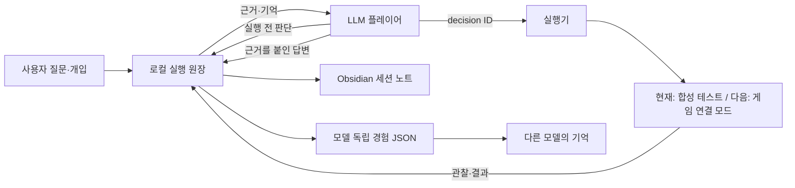

> Current live structure: [2026-10-20 research entrypoint](research-entrypoint-20261020.md). The v0.1 content below is historical.

# v0.1 구조와 구현 경계

이 문서는 초기 v0.1 구현 당시의 구조 기록입니다. 향후 설계 기준은
[AI 전용 게임기 설계 초안](ai-console-design.md), 실제 연결의 후속 구현 상태는
[인계 기록](handoff.md)을 참고하세요. 새 설계 중 최소 입력·세 UI·소리 이벤트·캡처를 구현했으며
현재 검증 경계는 [최소 게임기 보고서](console-minimum-verification.md)를 따릅니다.

## 결정

모델은 주요 선택을 맡고 실행기는 지정된 행동만 수행한다. 기억은 모델 밖에 둔다.
다른 모델로 바꿀 때 옮기는 대상은 모델 내부 상태가 아니라 근거가 연결된 경험과 플레이어 상태다.

## 현재 도구

`start_session`, `list_sessions`, `observe`, `record_decision`, `execute_decision`,
`record_reflection`, `read_timeline`, `reply_to_human`, `search_memory`, `checkpoint`.

MCP가 모델을 실행하는 구조가 아니다. Codex/다른 호스트가 모델을 실행하고 이 도구를 호출한다.
API 기반 자율 실행기, 모델 비용/토큰 계측, 비동기 깨우기, UI 대시보드는 아직 없다.
v0.1에서 제한하는 예산은 **세션별 행동 횟수**뿐이다. 총 모델 비용이나 벽시계 시간을 제한하지 않는다.

## 사건 형식

공통: `id`, `session_id`, 로컬 원장 순서 `seq`, UTC `created_at`, `kind`, `data`.

- `observation`: 플레이어에게 전달한 상태, revision, 사람 메시지
- `decision`: 관찰 ID, 행동, 목표, 짧은 이유, 예상 결과, 불확실성, 참조한 기억 ID
- `outcome`: 판단 ID, 실제 명령, 전후 상태, 결과 revision
- `reflection`: 결과 ID, 새 가설/교훈, 남은 불확실성, 다음 방침
- `human_message`: 질문 또는 전략 개입
- `reply`: 메시지 ID, 답변, 근거 사건 ID
- `operator_control`: 일시정지/재개/종료

판단의 이유는 짧은 자기 보고이다. 내부 chain-of-thought를 저장하거나 해석했다고 주장하지 않는다.
예상과 실제 결과를 구별하고, 회고가 틀렸을 때 원문을 덮어쓰지 말고 새로운 회고로 정정한다.

## 일관성

SQLite 트랜잭션으로 모의 세계 변경과 outcome 기록을 함께 저장한다.
같은 판단 ID 재실행은 기존 결과를 반환한다. 상태 revision이 달라졌으면 실행을 거부한다.
사람의 전략 개입/일시정지는 revision을 바꾸며, 단순 질문은 바꾸지 않는다.
클라이언트가 종료되어도 원장이 남으며 재접속 후 세션 목록/타임라인을 읽을 수 있다.

이 보장은 인프로세스 합성 테스트에만 해당한다. 실제 게임은 별도 프로세스이므로 전송 후 응답 손실,
메인 스레드 실행, 명령 접수/적용 상태, 재연결을 추가 설계해야 한다.

## 깨끗한 플레이어 역할

개발 채팅은 게임 코드 분석과 테스트에 사용한다. 플레이어 채팅에는 공략과 분석 결과를 넣지 않는다.
학습된 사전 지식을 삭제했다고 가정하지 않는다. 모든 주요 가설에 관찰 근거/기존 지식 여부를 기록한다.
현재 MCP의 역할 분리는 프롬프트/도구 노출 수준이다. Codex가 셸·파일·다른 도구를 사용할 수 있으면
그 접근까지 차단하는 보안 경계는 아니다. 향후 통제 실험에는 전용 호스트/허용 도구 구성을 준비한다.

## 검증 상태

합성 원장 및 MCP 왕복, 중복·오래된 명령·중지·예산·이전 기록의 출처 보존을 검사한다.
실제 게임 적용, 세이브 복원, LLM의 판단 개선, 모델 간 경험 활용 효과는 아직 검증하지 않았다.
