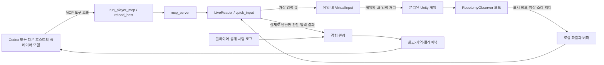

# 다른 에이전트를 위한 현재 구조와 최적화 조사 안내

기준: 2026-10-20. 개발/조사 에이전트용이며 플레이어에게 전달하는 공략이 아니다.
이 문서가 현재 진입점이다. architecture.md의 v0.1 및 과거 보고서는 당시 상태를 설명한다.
이번 게시 목적은 현행 소스 공유와 성능 조사다. 게임 재실행·패치 배포·최적화 구현 승인이 아니다.

## 폴더와 Git 경계

| 로컬 위치 | 역할 | Git에서 확인할 곳 |
|---|---|---|
| D:/Projects/Robotomy_AI | 개발 소스와 도구 | 이 저장소 |
| D:/Projects/Robotomy_Player | 플레이어용 별도 작업 폴더 | config/player 및 config/player-workspace-snapshot |
| D:/Projects/Robotomy_Lab | 별도 검증 환경 | 동일 소스 기반, 실행 데이터는 제외 |
| D:/SteamLibrary/steamapps/common/LobotomyCorp | 설치된 원본 게임 | 미포함 |
| Robotomy_AI/.robotomy/runtime/LobotomyCorp | 관찰 모드가 적용된 분리 실행본 | 미포함; scripts/prepare_live.py 참고 |
| Robotomy_AI/.robotomy/live | latest.json, 캡처, 입력 큐/응답, 오디오 이력 | 미포함; 소비·생산 코드는 포함 |
| Robotomy_AI/.robotomy/experience | SQLite 원장, 채팅 수집·Git 게시 상태 | 미포함 |
| Robotomy_AI/vault/Lobotomy-Experience | 경험, 회고, 페르소나, 플레이북 | 텍스트는 Git에 게시; Media 제외 |
| Robotomy_AI/.robotomy/plugin-marketplace | 로컬 플러그인과 MCP 경로 설정 | 생성기 scripts/setup_player_plugin.py |
| D:/NVIDIA/Lobotomycorp | 사용자 녹화 | 미포함 |

저장소를 clone하는 것만으로 게임을 실행할 수는 없다. 게임 설치, 로컬 환경 구성, 저장 격리 확인이 필요하다.
분리 실행본은 별도 Unity company/product Robotomy_AI/Lobotomy_Observer를 사용한다.
정확한 저장 위치와 원본 무결성은 prepare_live.py/launch_live.py 및 로컬 manifest로 검증한다.
원본 게임 데이터, 역컴파일 전체 산출물, 바이너리, 세이브, 영상, 인증 정보는 게시하지 않는다.

## 실제 연결

- 게임기는 모델을 구동하지 않는다. 판단은 호스트의 플레이어 모델이 한다. 기본 로컬 도구는 별도 유료 모델 API를 호출하지 않는다.
- 생산자는 게임 루프에서 관찰을 계속 갱신한다. 플레이어는 도구를 호출할 때 반환된 관찰을 읽는다. 생산이 연속적이라고 모델 인지가 연속적인 것은 아니다.
- 화면 표시 정보 추출은 mods/RobotomyObserver/ConsoleUI.cs 및 각 Console*.cs, 공개 경계는 ConsoleDisclosure.cs에 있다.
- 위치/벡터는 ConsoleMotion.cs, 시설 연결과 상대 위치는 ConsoleFacilityMap.cs, 상태는 ConsoleFacilityStatus.cs에서 계산한다.
- 입력은 robotomy/quick_input.py → virtual_input.py/live_control.py → 게임 내 VirtualInput.cs. OS 마우스/Windows 브리지 없이 가상 입력을 제공한다. 직원 선택에는 실행 시점 좌표를 다시 검증하는 경로도 있다.
- 입력 후 fresh 관찰을 반환하지만 input_sent/ready는 의도한 게임 행동의 성공 증명이 아니다.
- 화면 관찰 웹페이지는 관찰용이다. 가상 입력은 게임으로 직접 간다.
- reload_host는 HOT 모듈의 변경을 호출 사이에서 반영한다. PINNED 모듈·스키마·게임 DLL 변경의 적용 조건은 서로 다르다. 소스 최신 여부와 실행 중 배포 버전은 같다고 가정하지 말 것.
- scripts/launch_live.py와 start_game_task.ps1이 게임 생명주기를 호스트 앱과 분리한다.
- experience.py, chat_capture.py, playbook.py, reading_index.py가 사건·공개 발언·기억과 조회를 맡는다. 공개 판단 설명을 기록하며 비공개 추론 원문을 수집하지 않는다.
- git_sync.py는 별도 게시 폴더에서 player-experience 브랜치로 경험을 동기화한다. main과 항상 같다는 의미는 아니다. 이번 게시에서 실행 중 기록 파일을 덮어쓰지 않았다.

## 읽는 순서

1. 이 문서와 [최적화 조사 결과](diff-optimization-audit-20261020.md)
2. config/player/AGENTS.md 및 RUN-PROMPT.md: 플레이어가 보는 사용 규칙
3. robotomy/quick_input.py, live.py: 응답 구성, diff, 입력 후 결과
4. robotomy/mcp_server.py, reload_host.py: MCP 도구와 호출/재로딩 경계
5. mods/RobotomyObserver/Observer.cs, VirtualInput.cs와 필요한 Console*.cs
6. docs/facility-map-and-entities.md, docs/disclosure-implementation.md, docs/player-experience-dataset.md

## 조사 요청과 제한

목표는 조작 정확도를 유지하며 관찰→판단→입력의 총 지연과 모델에 전달하는 양을 줄이는 것이다.
우선 구조와 실제 데이터 흐름을 읽고 제안/측정 설계를 제출한다. 게임 입력·재시작·세이브 복원·배포는 하지 않는다.
게임 파일에 연동된 변경은 실제 구현과 prefab/표시 경로를 확인한다. 오래된 Unity의 기본 동작을 추정으로 대체하지 않는다.
숨겨진 목표/상태/공략을 간편 정보로 누출하지 않는다. 카메라 밖 현재 정보도 추론으로 보충하지 않는다.
자동 일시정지, 자동 전투 판단, 스크래치형 실행기는 이번 조사에서 구현하지 않는다.
원문 경험 기록을 바꾸지 말고, 정정은 별도 기록으로 남긴다.

추천 조사 영역: 응답 중복/스키마, 비교 기준/관찰 연속성, 직원 식별과 클릭 토큰 분리,
소리 표현/중요 신호 보존, 호스트 호출 시간 계측. 각 제안에는 정보 손실·지연·성능 비용을 구분한다.
현재 원장/영상은 비공개 로컬 자료이므로 원격 에이전트는 아래 집계만으로 실시간 검증을 했다고 주장하면 안 된다.

실시간 v2 본 플레이 배포: [구현 및 검증](realtime-v2-implementation-20261020.md).
